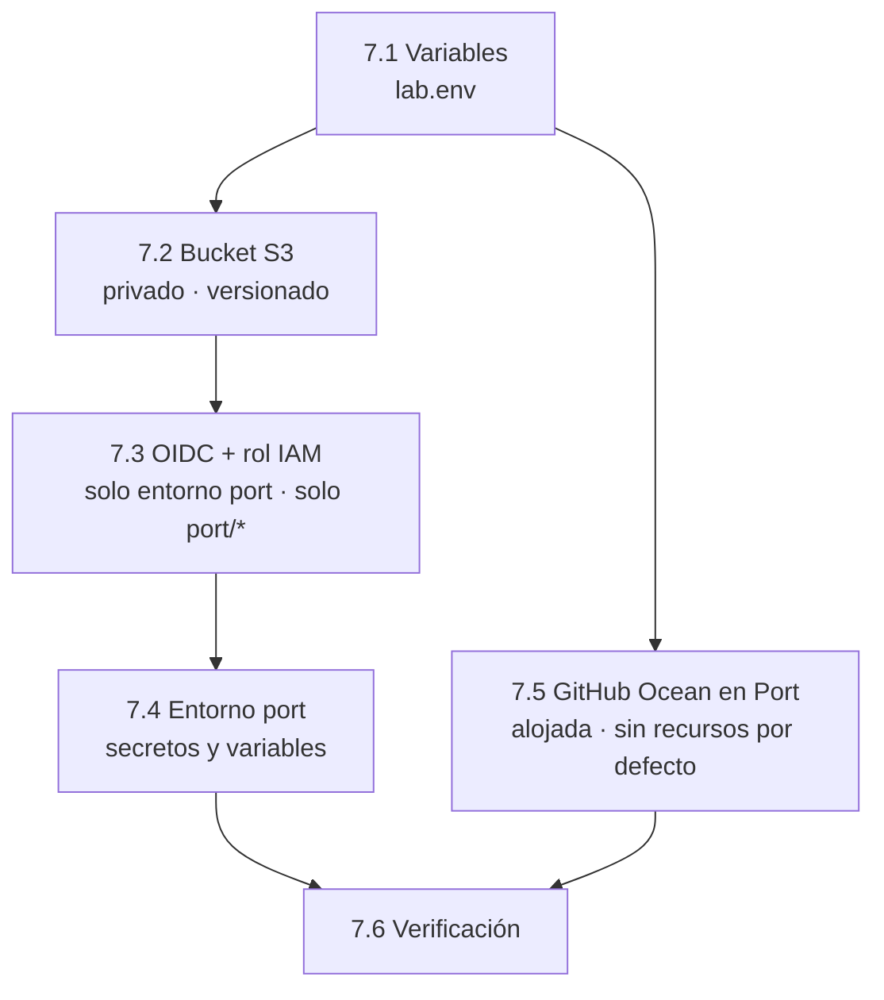

# Paso 07 · Preparar Port como código: estado en S3, rol OIDC y GitHub Ocean

> Preparación manual de la **fase 3** ([ADR 0016](../adr/0016-linaje-mixto-port.md),
> [ADR 0017](../adr/0017-port-como-codigo-terraform.md)). Diseño: [lab/port](../lab/port.md).

## Objetivo

Dejar listo todo lo que **no** puede hacer Terraform por sí mismo:

- dónde guarda su estado (S3);
- con qué identidad entra GitHub Actions en AWS (OIDC, sin claves);
- las credenciales de Port en el entorno `port` del repo;
- la integración de GitHub instalada en Port, **vacía**, para que su *mapping* lo escriba Terraform en F3.1.

**Hecho cuando:**
- el bucket existe, es privado y está versionado;
- el rol `github-port-terraform` solo lo puede asumir el entorno `port` de `agentic-platform-lab`;
- el entorno `port` tiene sus 3 secretos y 2 variables;
- la API de Port lista la integración de GitHub.



## Prerrequisitos

- `aws` con un perfil que pueda crear buckets y roles de IAM (el mismo del paso 04). Si usas un
  perfil con nombre, expórtalo antes en `AWS_PROFILE`.
- `gh` autenticado como propietario de la org, **sin paginador** (`gh config set pager cat`; si no,
  las salidas se abren en `less` y no se pueden copiar) · `op` con acceso a `agentic-lab` ·
  `terraform` ≥ 1.10.
- Credenciales de Port ya en 1Password: `agentic-lab/Port Org` (campos `ClientId` y `ClientSecret`).

## Pasos

### 7.1 · Variables

Añade a tu `lab.env` (no va al repo):

```bash
AWS_REGION=eu-west-1                                # activada por defecto (Madrid, eu-south-2, requiere opt-in)
TF_STATE_BUCKET=apl-tfstate-$(openssl rand -hex 4)  # nombre global único: fíjalo tras generarlo
```

> Genera el nombre una vez (`echo apl-tfstate-$(openssl rand -hex 4)`) y **escribe el valor
> literal** en `lab.env`. Si dejas el `$(…)`, cada `source` daría un bucket distinto.

```bash
set -a; source lab.env; set +a
export AWS_PAGER=""
export AWS_ACCOUNT_ID="$(aws sts get-caller-identity --query Account --output text)"
echo "$TF_STATE_BUCKET · $AWS_REGION · cuenta ${AWS_ACCOUNT_ID:0:4}…"
```

### 7.2 · Bucket del estado

```bash
aws s3api create-bucket --bucket "$TF_STATE_BUCKET" --region "$AWS_REGION" \
  --create-bucket-configuration LocationConstraint="$AWS_REGION"
aws s3api put-public-access-block --bucket "$TF_STATE_BUCKET" \
  --public-access-block-configuration BlockPublicAcls=true,IgnorePublicAcls=true,BlockPublicPolicy=true,RestrictPublicBuckets=true
aws s3api put-bucket-versioning --bucket "$TF_STATE_BUCKET" --versioning-configuration Status=Enabled
aws s3api put-bucket-encryption --bucket "$TF_STATE_BUCKET" \
  --server-side-encryption-configuration '{"Rules":[{"ApplyServerSideEncryptionByDefault":{"SSEAlgorithm":"AES256"}}]}'
```

El versionado es tu red: un `apply` desastroso se deshace recuperando la versión anterior del estado.

### 7.3 · Proveedor OIDC de GitHub y rol IAM

```bash
# El proveedor OIDC es uno por cuenta: créalo solo si no existe
aws iam list-open-id-connect-providers --query 'OpenIDConnectProviderList[].Arn' --output text \
  | grep -q token.actions.githubusercontent.com \
  || aws iam create-open-id-connect-provider \
       --url https://token.actions.githubusercontent.com --client-id-list sts.amazonaws.com

# Prefijo del 'sub' que firma GitHub para este repo. Los repos nuevos usan *sujetos inmutables*
# (repo:<org>@<id>/<repo>@<id>), no repo:<org>/<repo>: hay que preguntarlo, no suponerlo.
export OIDC_SUB_PREFIX="$(gh api repos/$GH_ORG/agentic-platform-lab/actions/oidc/customization/sub \
  --jq '.sub_claim_prefix // "repo:'"$GH_ORG"'/agentic-platform-lab"')"
echo "$OIDC_SUB_PREFIX"

envsubst < setup/aws/github-port-terraform-trust.json.tpl > /tmp/trust.json
envsubst < setup/aws/port-terraform-state-policy.json.tpl > /tmp/policy.json
grep -c '\${' /tmp/trust.json /tmp/policy.json   # 0 y 0: no queda ninguna variable sin sustituir

aws iam create-role --role-name github-port-terraform \
  --description "agentic-platform-lab: estado de Terraform de Port (solo entorno port)" \
  --assume-role-policy-document file:///tmp/trust.json --query Role.Arn --output text
aws iam put-role-policy --role-name github-port-terraform \
  --policy-name tfstate-port --policy-document file:///tmp/policy.json
rm /tmp/trust.json /tmp/policy.json
```

Qué permite exactamente:

| Quién | Condición | Puede |
|---|---|---|
| un job de GitHub Actions | `sub = repo:elpalmeral-org@<id>/agentic-platform-lab@<id>:environment:port` (sujeto inmutable) | asumir el rol |
| el rol | — | leer, escribir y borrar `s3://<bucket>/port/*` (estado y su `.tflock`); listar ese prefijo |

Ningún otro repo, rama sin entorno o *fork* puede asumirlo.

### 7.4 · Entorno `port` en GitHub

```bash
R=elpalmeral-org/agentic-platform-lab
gh api -X PUT repos/$R/environments/port --silent

gh secret set PORT_CLIENT_ID     --env port -R $R --body "$(op read -n 'op://agentic-lab/Port Org/ClientId')"
gh secret set PORT_CLIENT_SECRET --env port -R $R --body "$(op read -n 'op://agentic-lab/Port Org/ClientSecret')"
gh secret set AWS_ROLE_ARN       --env port -R $R --body "arn:aws:iam::${AWS_ACCOUNT_ID}:role/github-port-terraform"
gh variable set TF_STATE_BUCKET  --env port -R $R --body "$TF_STATE_BUCKET"
gh variable set AWS_REGION       --env port -R $R --body "$AWS_REGION"
```

El ARN va como **secreto** (no como variable) para que GitHub lo enmascare en los logs públicos: lleva el ID de la cuenta.

> El entorno no limita ramas a propósito: el `plan` corre en las ramas de los PR. El `apply`
> solo se ejecutará en `main` (lo controla el workflow de F3.1). Los PR desde *forks* no reciben
> secretos ni pueden pedir el token OIDC del entorno.

### 7.5 · GitHub Ocean en Port (alojada por Port)

En Port → **Data sources** → **+ Data source** → **GitHub (Ocean)**:

1. Instalación: **Hosted by Port**, autenticación con la **GitHub App de Port**.
2. Instala la app en `elpalmeral-org` con **Only select repositories**: `meridian-orders` y
   `platform-gitops`.
3. **Si aparece la opción "Create default resources", desactívala.** La documentación de Port no
   dice en qué pantalla está; lo normal es que salga al volver a Port tras instalar la app, junto a
   *Use Custom Settings*. Si no aparece, sigue: Port creará sus blueprints `github*` y su
   *mapping* por defecto, y en F3.1 Terraform los **importará o los borrará** (se decide al ver
   qué ha creado). No hay que repetir la instalación.
4. Anota el **identificador de la integración** (aparece en la ficha del *data source*). Lo
   necesitamos en F3.1.

## Verificación

```bash
aws s3api get-public-access-block --bucket "$TF_STATE_BUCKET" --query 'PublicAccessBlockConfiguration' --output text
aws s3api get-bucket-versioning   --bucket "$TF_STATE_BUCKET" --query Status --output text      # Enabled
aws iam get-role --role-name github-port-terraform \
  --query 'Role.AssumeRolePolicyDocument.Statement[0].Condition.StringEquals' --output json
gh secret list --env port -R elpalmeral-org/agentic-platform-lab     # 3 secretos
gh variable list --env port -R elpalmeral-org/agentic-platform-lab   # 2 variables

# Port: la credencial funciona y la integración existe
tok=$(jq -n --arg id "$(op read -n 'op://agentic-lab/Port Org/ClientId')" \
            --arg s "$(op read -n 'op://agentic-lab/Port Org/ClientSecret')" '{clientId:$id, clientSecret:$s}' \
  | curl -fsS -X POST https://api.getport.io/v1/auth/access_token -H 'Content-Type: application/json' -d @- \
  | jq -r .accessToken)
curl -fsS https://api.getport.io/v1/integration -H "Authorization: Bearer $tok" \
  | jq -r '.integrations[] | "\(.installationId) · \(.integrationType) · \(.installationAppType // "-")"'
unset tok
```

Esperado: cuatro `True`, `Enabled`, la condición con `…:environment:port`, 3 secretos, 2 variables
y una línea con la integración de GitHub.

## Problemas típicos

| Síntoma | Causa | Solución |
|---|---|---|
| `BucketAlreadyExists` | el nombre ya lo usa otra cuenta en el mundo | genera otro sufijo |
| `IllegalLocationConstraintException` | región `us-east-1` | en esa región se omite `--create-bucket-configuration` |
| `EntityAlreadyExists` en el proveedor OIDC | ya existía | es correcto: el `grep` lo evita la segunda vez |
| `Not authorized to perform sts:AssumeRoleWithWebIdentity` en el workflow | el `sub` del token no coincide con la política: el repo usa **sujetos inmutables** (`use_immutable_subject: true`) | recalcular `OIDC_SUB_PREFIX` y `aws iam update-assume-role-policy` (ver 7.3) |
| `401` en `access_token` de Port | `op read` sin `-n` o credencial antigua | usar `-n`; regenerar en Port → *Credentials* y actualizar 1Password |
| En Port aparecen blueprints `githubRepository`… | no hubo opción de desactivar los recursos por defecto, o quedó activada | nada: en F3.1 Terraform los importa o los borra |

## Marcha atrás

```bash
aws iam delete-role-policy --role-name github-port-terraform --policy-name tfstate-port
aws iam delete-role --role-name github-port-terraform
aws s3 rb "s3://$TF_STATE_BUCKET" --force     # solo si está vacío de estado que te importe
gh api -X DELETE repos/elpalmeral-org/agentic-platform-lab/environments/port
```

En Port, borra el *data source* de GitHub y desinstala la app de Port en la org.

## 📣 Qué tienes que confirmarme

1. La salida de la **verificación**. Recorta el ID de cuenta si aparece.
2. El **identificador** de la integración de GitHub en Port.
