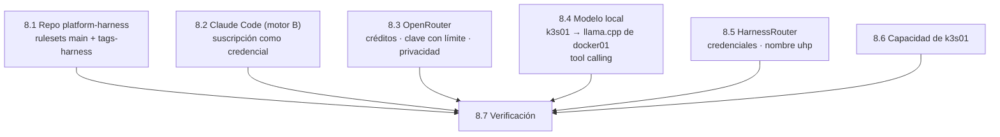

# Paso 08 · Preparar el harness: repo, proveedores de modelos y gateway

> Preparación manual de la **fase 4** ([ADR 0022](../adr/0022-harness-repo-propio-formatos-abiertos.md),
> [ADR 0023](../adr/0023-apm-distribucion-harness-ok.md),
> [ADR 0024](../adr/0024-harnessrouter-en-f4-proveedores.md),
> [ADR 0025](../adr/0025-dos-motores-un-harness.md)). Diseño: [lab/harness](../lab/harness.md).
> Dos motores: **A · abierto** (HarnessRouter con OpenRouter y Bonsai) y **B · Claude Code** con tu
> suscripción, en el Mac.

## Objetivo

Dejar listo lo que F4 no puede hacer por código:

- el repo `platform-harness`, con sus reglas: solo entra por PR y **solo tú creas tags `harness-v*`**,
  que es lo que hará fiable la firma de cada release;
- Claude Code en el Mac con tu **suscripción** como credencial activa (motor B);
- la clave de OpenRouter **con límite de gasto** en 1Password (motor A);
- la comprobación de que el clúster llega al modelo local de docker01 y de que ese modelo sabe
  llamar a herramientas;
- las credenciales del gateway (HarnessRouter) y su nombre;
- una foto de la capacidad libre de k3s01, para dimensionar HarnessRouter en F4.6.

**Hecho cuando:**
- `platform-harness` existe, es público y tiene los rulesets `main` y `tags-harness` activos;
- Claude Code muestra tu suscripción en `/status` y no hay ninguna `ANTHROPIC_*` en el entorno;
- `openrouter-api` está en `agentic-lab`, responde y tiene límite;
- un pod de k3s01 lista los modelos de `llama.cpp` y el modelo devuelve un `tool_calls`;
- `harnessrouter` está en `agentic-lab` y `uhp.apl.<dominio>` resuelve a k3s01;
- tienes las cifras de CPU, memoria y disco libres de k3s01.



## Prerrequisitos

- `gh` autenticado como propietario de la org y sin paginador (`gh config set pager cat`) · `op`
  con acceso a `agentic-lab` · `kubectl` contra k3s01 · `jq`.
- Para F4.1 (no hace falta todavía, pero ya que estás): `brew install apm` y
  `npm install -g @fission-ai/openspec@latest`.
- Una tarjeta para OpenRouter. La cifra de esta guía (10 $) es un techo de laboratorio: ajústala.
- Claude Code instalado en el Mac y tu suscripción Pro o Max.

```bash
cd ~/git/homelab/agentic-platform-lab
set -a; source lab.env; set +a
R=elpalmeral-org/platform-harness
```

## Pasos

### 8.1 · Repo `platform-harness`

```bash
gh repo create $R --public --add-readme --license apache-2.0 \
  --description "Harness corporativo del agentic-platform-lab: instrucciones, skills, agentes, MCP y políticas en formatos abiertos (APM · Agent Plugins · UHP)"
gh repo edit $R --add-topic harness-engineering,apm,agent-skills,agent-plugins,uhp
gh api -X PATCH repos/$R -F delete_branch_on_merge=true \
  -F allow_squash_merge=true -F allow_merge_commit=false -F allow_rebase_merge=false \
  --jq '{delete_branch_on_merge, allow_squash_merge}'
```

Ruleset de `main`: igual que en los otros repos, pero todavía **sin checks obligatorios** (el CI
llega en F4.1; si lo exigimos antes, bloquea el primer PR).

```bash
gh api -X POST repos/$R/rulesets --input - --jq '{id, name, enforcement}' <<'EOF'
{
  "name": "main",
  "target": "branch",
  "enforcement": "active",
  "conditions": { "ref_name": { "include": ["~DEFAULT_BRANCH"], "exclude": [] } },
  "rules": [
    { "type": "deletion" },
    { "type": "non_fast_forward" },
    { "type": "pull_request", "parameters": {
        "required_approving_review_count": 0,
        "dismiss_stale_reviews_on_push": false,
        "require_code_owner_review": false,
        "require_last_push_approval": false,
        "required_review_thread_resolution": false } }
  ]
}
EOF
```

Ruleset de tags: los tags `harness-v*` **solo los crea, mueve o borra un administrador** del repo
(tú). Así, «firmado por `harness-release.yml` en un tag `harness-v*`» significa «una versión que
publicó la plataforma», y nadie puede mover un tag ya publicado para cambiar su contenido.

```bash
gh api -X POST repos/$R/rulesets --input - --jq '{id, name, enforcement}' <<'EOF'
{
  "name": "tags-harness",
  "target": "tag",
  "enforcement": "active",
  "conditions": { "ref_name": { "include": ["refs/tags/harness-v*"], "exclude": [] } },
  "bypass_actors": [ { "actor_id": 5, "actor_type": "RepositoryRole", "bypass_mode": "always" } ],
  "rules": [ { "type": "creation" }, { "type": "update" }, { "type": "deletion" } ]
}
EOF
```

`actor_id: 5` es el rol *Admin* del repositorio.

> **Releases inmutables.** Si en *Settings › General › Releases* aparece **Enable release
> immutability**, actívalo: una release publicada ya no puede cambiar sus ficheros ni su tag.

> La GitHub App `elpalmeral-platform-bot` **no** se instala en este repo: el workflow de release
> solo la usa para abrir PR de *upgrade* en los repos consumidores, donde ya está instalada. Su clave
> llega por el secreto de la org `PLATFORM_BOT_PRIVATE_KEY` (visible para todos los repos públicos).

### 8.2 · Claude Code con tu suscripción (motor B)

El motor B es Claude Code **sin modificar**, en tu Mac, con tu sesión de claude.ai. No hay clave que
crear ni nada que guardar en 1Password: en CI no corre ([ADR 0025](../adr/0025-dos-motores-un-harness.md)).

```bash
claude update && claude --version
env | grep -E '^ANTHROPIC_(API_KEY|AUTH_TOKEN|BASE_URL)=' && echo "⚠️ quita estas variables" || echo "✅ sin ANTHROPIC_* en el entorno"
```

Abre `claude`, ejecuta `/status` y comprueba que la línea de autenticación es tu **cuenta de
Claude** (Pro o Max), no una clave de API. Si hubiera una `ANTHROPIC_API_KEY`, Claude Code la
usaría antes que la suscripción.

> **Por qué la suscripción no va a HarnessRouter.** Vale para tu Claude Code (y para tu propio CI con
> `claude setup-token`), pero HarnessRouter es un gateway de terceros que guarda la credencial y lanza
> agentes por ti, y Anthropic no permite que herramientas de terceros almacenen o enruten
> credenciales de claude.ai ([Legal and compliance](https://code.claude.com/docs/en/legal-and-compliance#authentication-and-credential-use)).
> Por eso el motor A no lleva modelos de Anthropic.

### 8.3 · OpenRouter: créditos, clave con límite y privacidad

En <https://openrouter.ai>:

1. **Settings › Credits** → añade `10 $`.
2. **Settings › Privacy**: desactiva los proveedores que puedan **entrenar con tus datos** y, si
   aparece, activa **solo endpoints con retención cero** (*Zero Data Retention*). Es el argumento
   que pedirá el CISO: cuando el trabajo sale a un modelo de terceros, decides a cuáles.
3. **Settings › Keys › Create key** → nombre `harnessrouter-k3s01`, **Credit limit** `10 $`.

> **Sin modelos de Anthropic en el motor A** ([ADR 0025](../adr/0025-dos-motores-un-harness.md)): la regla la
> aplica `uhp/roles.yaml`, con un test en F4.1. Si en los ajustes de OpenRouter puedes **ignorar
> proveedores**, añade Anthropic como defensa extra.

```bash
op item create --vault agentic-lab --category "API Credential" --title openrouter-api \
  "credential[password]=$(pbpaste)" "uso[text]=HarnessRouter (k3s01)" >/dev/null \
  && echo "✅ en 1Password"; pbcopy </dev/null
```

### 8.4 · Modelo local: del clúster al `llama.cpp` de docker01

El `llama.cpp` del `ai-stack` (Ternary Bonsai 2 27B, alias `bonsai`) escucha en el puerto 11435
de docker01 con API compatible con OpenAI y `--jinja` (llamadas a herramientas). Añade a `lab.env`:

```bash
LLM_LOCAL_URL=http://docker01.${LAB_DOMAIN}:11435/v1    # si docker01 tiene otro nombre en la LAN, cámbialo
```

```bash
set -a; source lab.env; set +a
# 1) Conectividad desde un pod: es el camino que usará HarnessRouter
kubectl run llm-probe --rm -i --restart=Never --image=curlimages/curl:8.11.1 -- \
  curl -fsS "$LLM_LOCAL_URL/models"

# 2) ¿Sabe llamar a herramientas? (desde el Mac; ocupa un slot de Hermes unos segundos)
curl -fsS "$LLM_LOCAL_URL/chat/completions" -H 'Content-Type: application/json' -d '{
  "model": "bonsai", "max_tokens": 1024,
  "messages": [{"role": "user", "content": "¿Qué hora es en Madrid? Usa la herramienta."}],
  "tools": [{"type": "function", "function": {"name": "get_time",
    "description": "Hora actual de una ciudad",
    "parameters": {"type": "object", "properties": {"city": {"type": "string"}}, "required": ["city"]}}}]
}' | jq '{finish: .choices[0].finish_reason, tool_calls: .choices[0].message.tool_calls, tokens: .usage}'
```

Lo esperado: `finish: "tool_calls"` y una llamada a `get_time` con `{"city": "Madrid"}`. Si
contesta en texto sin llamar a la herramienta, apúntalo: es la primera pista para la pregunta Q8.

> **Sin clave, a propósito (de momento).** El `llama-server` no pide clave: hoy lo usan Hermes,
> Frigate y Open WebUI dentro de la LAN. HarnessRouter usará la misma vía. Poner una clave por
> consumidor (`--api-key-file`) obliga a tocar el `ai-stack` y queda en el backlog de F4.6.

### 8.5 · HarnessRouter: credenciales y nombre

El usuario de la Console y la clave con la que cifra lo que guarda (`HR_SECRET_KEY`) se generan
aquí y no salen de 1Password; ESO los llevará al clúster en F4.6. La clave de API para los
workflows se crea en la Console en F4.6.

```bash
op item create --vault agentic-lab --category Login --title harnessrouter \
  --generate-password='letters,digits,32' "username=pablo" \
  "secret_key[password]=$(openssl rand -base64 48 | tr -d '\n')" \
  "url[text]=https://uhp.${LAB_SUBDOMAIN}.${LAB_DOMAIN}" >/dev/null && echo "✅ en 1Password"
```

Nombre: **`uhp.apl.<dominio>`**, el previsto en la [ADR 0010](../adr/0010-nombres-publicos-gitops-y-doh.md).
El comodín `*.apl` ya apunta a k3s01 y su certificado ya lo cubre, así que no hay nada que crear:
solo comprobar que resuelve (8.7).

### 8.6 · Capacidad de k3s01

HarnessRouter es un contenedor de ~700 MB, pero instala las CLI de agente en su volumen (varios
GB si se dejan todas) y cada sesión ejecuta una CLI en memoria. Toma la foto:

```bash
kubectl top node
kubectl describe node | sed -n '/Allocated resources/,/Events/p'
ssh ${K3S_SSH_USER}@${K3S_FQDN} 'df -h / /var/lib/rancher 2>/dev/null; free -h'
```

## Verificación

```bash
set -a; source lab.env; set +a; R=elpalmeral-org/platform-harness
echo "— repo";      gh repo view $R --json visibility --jq .visibility
                    gh api repos/$R/rulesets --jq '.[] | "\(.name) · \(.target) · \(.enforcement)"'
echo "— 1Password"; for i in openrouter-api harnessrouter; do
                      op item get $i --vault agentic-lab >/dev/null 2>&1 && echo "✅ $i" || echo "⛔ $i"; done
echo "— Claude Code"; claude --version
                      env | grep -cE '^ANTHROPIC_(API_KEY|AUTH_TOKEN|BASE_URL)=' | sed 's/^/variables ANTHROPIC_*: /'
echo "— OpenRouter"; curl -s https://openrouter.ai/api/v1/key \
                      -H "Authorization: Bearer $(op read -n op://agentic-lab/openrouter-api/credential)" \
                      | jq '{limite: .data.limit, gastado: .data.usage}'
echo "— DNS";       dig +short uhp.${LAB_SUBDOMAIN}.${LAB_DOMAIN}; echo "(debe ser la IP de k3s01)"
```

Esperado: `PUBLIC`, dos rulesets `active`, dos ✅, una versión de Claude Code, `variables ANTHROPIC_*: 0`,
un límite distinto de `null` y la IP de k3s01.

## Problemas típicos

| Síntoma | Causa | Arreglo |
|---|---|---|
| `Validation Failed` al crear `tags-harness` | `actor_id` no válido en tu org | Créalo en la UI (*New tag ruleset*) con *Bypass list › Repository admin* |
| `/status` muestra una clave de API | Hay una `ANTHROPIC_API_KEY` en el entorno o aprobada en `/config` | `unset ANTHROPIC_API_KEY`, quítala del perfil de la shell y desactiva *Use custom API key* en `/config` |
| OpenRouter muestra `limite: null` | La clave se creó sin *Credit limit* | Edita la clave y pon el límite |
| El pod no resuelve `docker01…` | CoreDNS no reenvía el dominio de la LAN | Prueba con la IP; si funciona, se arregla en F4.6 con un `Service` *ExternalName* o un `Endpoints` |
| `connection refused` en 11435 | `bonsai` parado o recargando (~5 min la primera carga) | `sudo docker ps` en docker01 y su *healthcheck* |

## Marcha atrás

```bash
gh repo delete elpalmeral-org/platform-harness --yes
for i in openrouter-api harnessrouter; do op item delete $i --vault agentic-lab; done
```

Revoca también la clave en la consola de OpenRouter.

## 📣 Qué tienes que confirmarme

1. La salida de la **verificación** y lo que muestra `/status` en la autenticación (sin el correo, si prefieres). Ninguna línea muestra secretos.
2. La salida de la prueba de **tool calling** de 8.4 (`finish`, `tool_calls` y `tokens`).
3. Las cifras de **capacidad** de 8.6.
4. Si activaste **releases inmutables** (o si no aparecía la opción).
